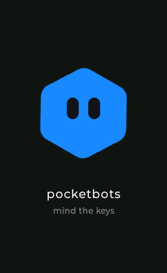
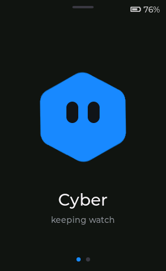
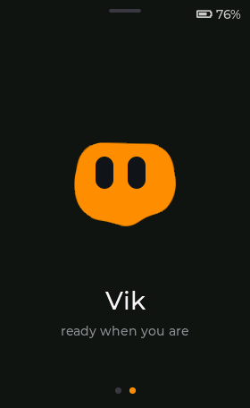
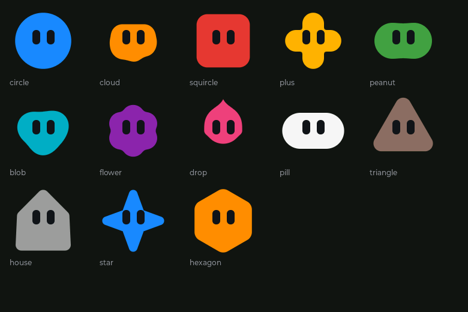
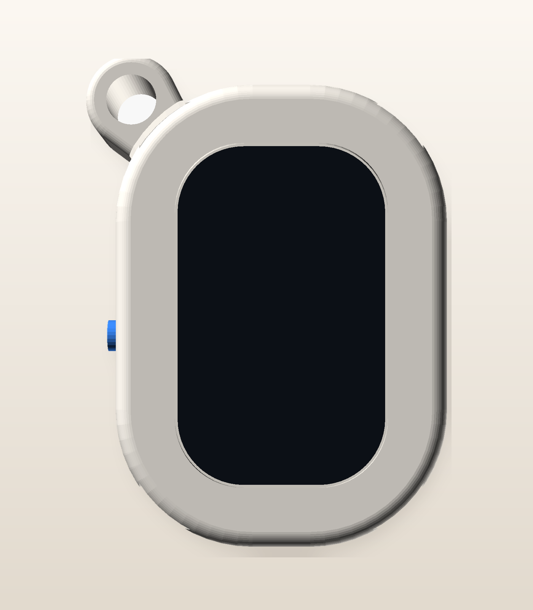
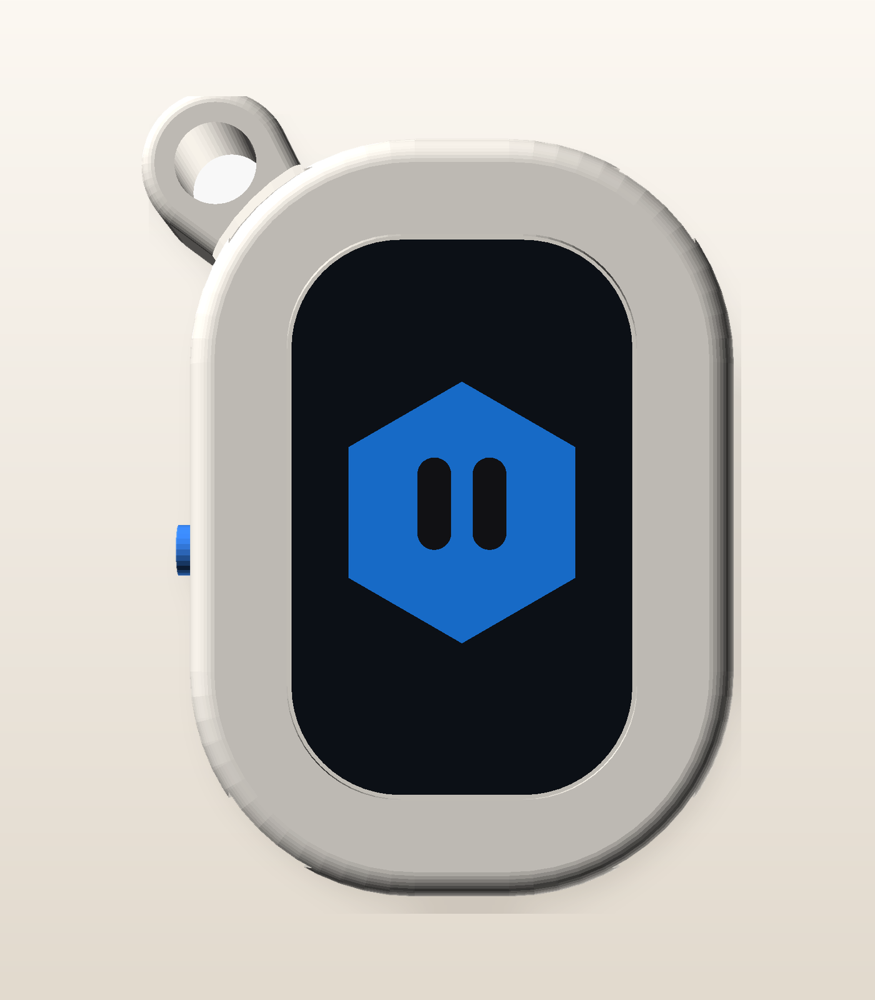
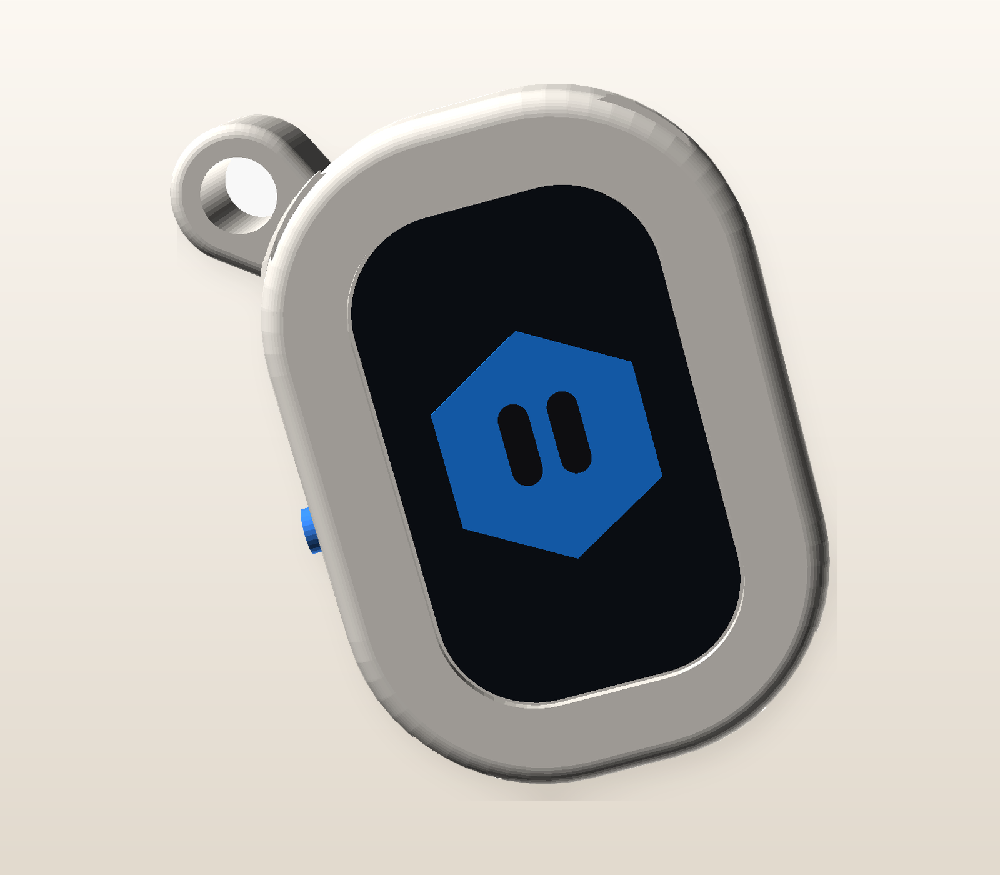
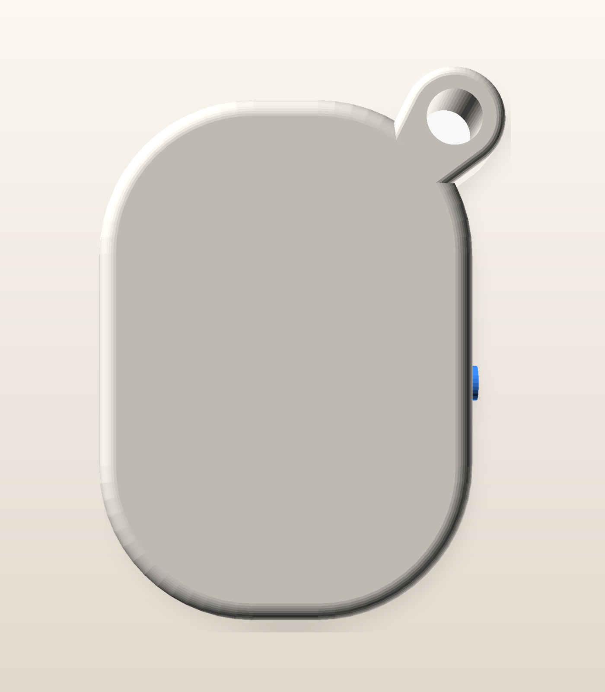

# pocketbots

A small squircle on a keyring, with a glass front, that shows your bots. Swipe, or press the button. Cyber keeps watch. Vik is ready when you are.

It is the shape of an [Amoeba One](https://www.amoebaone.com/), and then it declines to be a phone.



## The board

A [Waveshare ESP32-S3-Touch-AMOLED-1.64](https://www.waveshare.com/esp32-s3-touch-amoled-1.64.htm), revision **V1.1**. The module is 29 × 44 mm, the glass is 280 × 456, and there is a PicoBlade socket for a single LiPo, which is what makes it a keychain rather than a devkit with a screen glued on.

The 1.8 inch board from the same family is easier to find and has a speaker. It is also a different shape, and this case will not take it. The Pi Hut does not list this exact 1.64 module (they list the RP2350 version of the glass, which is a different chip).

V1.1 is the default. It has reverse-polarity protection on the cell and a wired touch interrupt, so a finger can wake it. V1 still builds (`pio run -e esp32s3-v1`) and wakes from the button only.

What to buy, the pins, and which numbers on the case are still guesses: [docs/hardware.md](docs/hardware.md).

## On the glass

Dark ground, one big mark, the name underneath. Dots along the bottom. The battery sits in the corner and says `usb` when there is no cell to measure.

A short press of BOOT goes to the next bot. Hold it and you go back. The little handle at the top, or the battery itself, opens the brightness. It is remembered when you let go. After 20 seconds of nothing it dims; after 90 it sleeps. Touch wakes a V1.1. The button wakes either.




<details>
<summary>Things it will not mention unless you ask</summary>

Tap the mark three times and it bounces, and mutters.

Press and hold the line under the name, or give the whole thing a proper shake (not a fidget; the accelerometer wants three strong samples in a row). A third bot turns up and stays. The flag lives in NVS. Shake it again after that and it only confirms it is awake.

Shaking does not wake it from sleep. The CPU is the thing doing the listening, and during light sleep it isn't. Same limit Keybuddy ran into on this board.

</details>

## Marks

Each bot is a flat blob and two dark eyes. No outline, no gradient, no little body hiding off the bottom of the glass. The shape and the colour live in [`assets/bots.json`](assets/bots.json). Cyber is a blue hexagon. Vik is an orange cloud. Both are drawn in the firmware, so the eyes can blink, glance at a swipe, and the body can squash a little when the card settles.



Shapes: circle, cloud, squircle, plus, peanut, blob, flower, drop, pill, triangle, house, star, hexagon.

Colours, by name: white, brown, red, orange, amber, green, teal, blue (`#1E88FF`), purple, pink, grey. A hex code works too.

A PNG still works, if you would rather drop one in. Put it under `assets/`, set `"image"` on the bot, run `python3 tools/png_to_c.py`. It bobs. It does not grow eyes. The two files in `assets/avatars/` have the word PLACEHOLDER baked into them so they can't be mistaken for finished faces, and the firmware does not use them.

## The case

The shape to chase was the [Amoeba One](https://www.amoebaone.com/): a moulded pebble, glass close to the edge, a little loop at one corner for the keys. This one is PLA rather than silicone, and the loop is printed with the back so the hole is a ring of perimeters. The two halves snap. There is nothing to unscrew on the face, or on the back.






The glass size comes from the module drawing. The USB slot and the button do not, because the drawing doesn't say. They are parameters at the top of [`enclosure/pocketbots.scad`](enclosure/pocketbots.scad). Print one, look, change a number. Steps are in [docs/assembly.md](docs/assembly.md). The STLs beside the scad match the defaults.

`enclosure/stl/bumper.stl` is a TPU skin for later. It is not part of the first print.

## Building

PlatformIO, in `firmware/`. The simulator runs on the host and draws the same UI into a framebuffer. The device build needs the 16 MB / octal-PSRAM environment; a 4 MB board file will not do.

```bash
cd firmware
pio run -e sim
pio run -e esp32s3 -t upload
```

[docs/flashing.md](docs/flashing.md) has the rest, including what to do when the picture is shifted or the colours are backwards. There is no Wi-Fi password in the tree. The radio is off. [SECURITY.md](SECURITY.md) says where a password would go if you ever turn it on.

## Credits

- [HackCharm](https://github.com/shiva233/HackCharm) — a keychain with a personality, which is the right amount of ambition.
- [Keybuddy](https://github.com/trkgmssy/Keybuddy) — the same Waveshare 1.64. The battery divider is ×3, the QMI8658 setup is theirs, and the shake threshold is too. Their case is a magnet; this one snaps shut.
- [ESP32 third-eye](https://github.com/Jekyllz/ESP32-third-eye) — another small thing on a ring, useful as a reminder of how little room there is.
- Waveshare's demos for this module, and the LilyGo boards that made QSPI CO5300 / SH8601 less of a private joke.
- Espressif's [`esp_lcd_co5300`](https://components.espressif.com/components/espressif/esp_lcd_co5300) from esp-iot-solution, Apache-2.0, vendored under `firmware/lib/esp_lcd_co5300`. One line of that header was changed so it compiles here. See [NOTICE](NOTICE).
- [trane77](https://github.com/trane77) for measuring the 20 px X gap this panel wants.
- [LVGL](https://lvgl.io/).

## Later

- A photograph of a bot, via the PNG path, if the blob isn't the face you wanted.
- The radio, so a bot can say something that isn't compiled in. Credentials in `secrets.h`, nowhere else.
- The TPU bumper.
- Waking from the IMU's own interrupt, so a shake works while it's asleep.
- More bots. Twelve is the current ceiling, which is already more pockets than the ring has.
