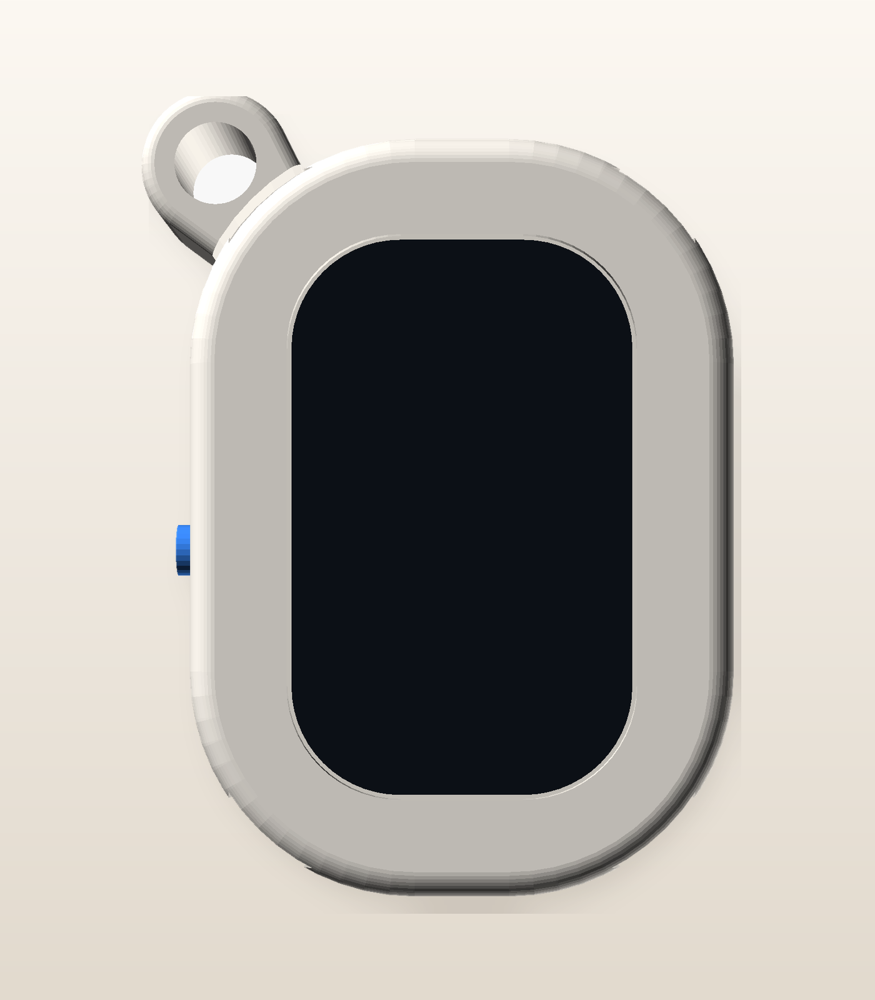
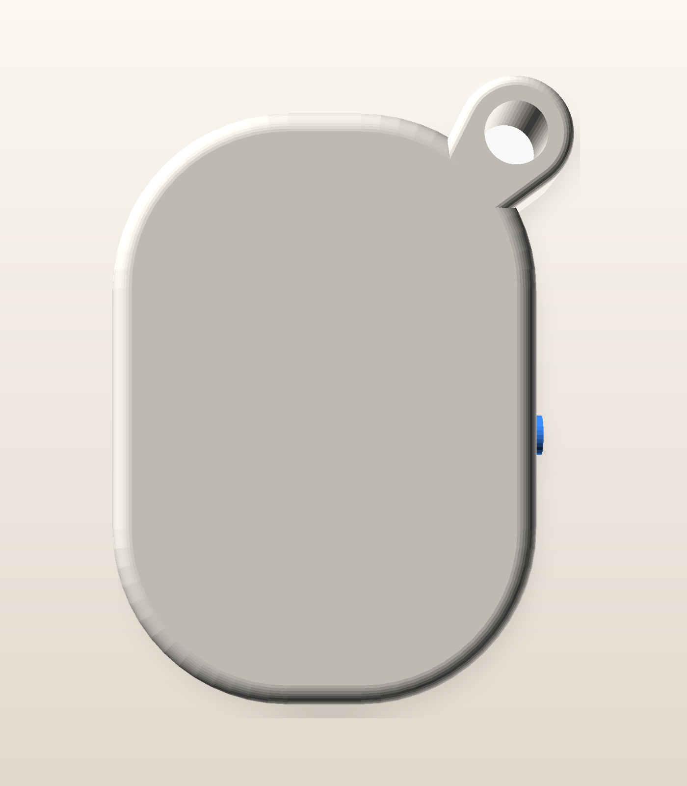

# Assembly

Two PLA shells and a loose plunger. They press together. The loop is part of the back, at the top-right corner, and it is as thick as the whole device so the hole is a ring of perimeters.

## Print

Open `enclosure/pocketbots.scad`. The STLs in `enclosure/stl/` match the defaults.

| Part | File | Orientation |
| --- | --- | --- |
| Front | `stl/front.stl` | Outside face on the bed, cavity up |
| Back | `stl/back.stl` | Outside face on the bed. The STL comes out of OpenSCAD with that face pointing up, so flip it |
| Plunger | `stl/plunger.stl` | Flange down |

0.2 mm layers, 4 perimeters, 30% infill. Give the loop 6 perimeters or solid infill. No supports. The window and the USB slot are open toward the bed or cut from the side.

`stl/bumper.stl` is a TPU jacket for later. Leave it.

## Numbers that are guesses

The module drawing gives the outline and the glass. It does not give the thickness, and it does not say where the USB-C plug or the BOOT button sit. Those are parameters at the top of the scad file:

- `board_t` — module thickness, screen included. Default 5.2.
- `usb_w`, `usb_h` — the slot in the bottom edge.
- `boot_from_centre` — along the right edge, glass facing you, USB at the bottom. Negative is toward the USB.

Print the front, sit the board in the opening, and only then close it up. A wrong button is a reprint of one shell.

## Putting it together

1. Test-fit the board in the front. Screen toward the window, sitting just behind the bezel. The opening is 0.3 mm larger than the module.
2. Battery in the pocket on the inside of the back. Leads go through the notch toward the USB end, then into the PicoBlade socket. Read the silkscreen for polarity before that last step. The pocket is sized for a 302535.
3. Plunger in from the inside. The flange stays in the pocket; the stem is the blue dot on the right. Then the board.
4. Press the shells together. A lip on the front sinks into a groove on the back, and four small bumps click as it seats. If your printer runs fat and it will not close, pare the bumps. They are the circles on the lip.
5. A small split ring through the loop. The hole is 5.2 mm.

The charge LED is not on a GPIO. If it is glowing, the cell is charging, and the firmware cannot tell you that on the glass. A reading under 2.5 V on the sense pin is shown as USB rather than 0%, which is what you get with no cell plugged in.
